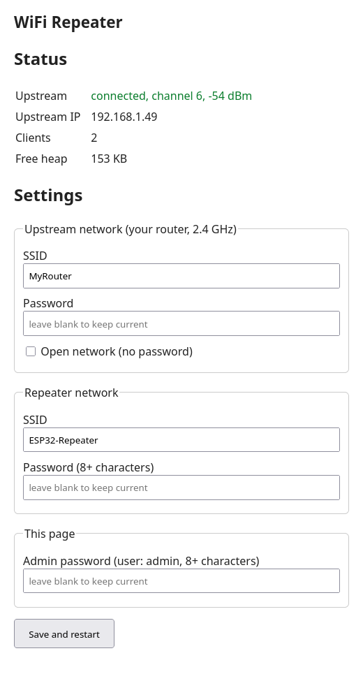

# ESP32-C6 WiFi Repeater

[](https://github.com/jmleclercq/esp32-wifi-repeater/actions/workflows/build.yml)
[](https://github.com/jmleclercq/esp32-wifi-repeater/releases/latest)
[](LICENSE)


**A small WiFi range extender for the ESP32-C6.** It joins your existing 2.4 GHz network and
re-broadcasts its own access point, routing traffic between the two with NAT. Configure it from
a web page: no rebuild, no serial console.

<p align="center"></p>
<p align="center"><em>The built-in web page (rendered from the firmware's HTML with example values).</em></p>

```
 Your devices ~~~ [ESP32-C6: AP 192.168.4.1/24]──NAT──[STA] ~~~ Router ── Internet
```

## Why this project?
- **Small and readable.** About 800 lines of plain ESP-IDF C, no external components: a good
  base to learn from or to adapt.
- **Made for the ESP32-C6**, with WiFi 6 (11ax) on 20 MHz channels.
- **Easy to run.** Flash a ready-made image, connect to the repeater, fill in a form.

Looking for a more feature-rich ESP32 NAT router? The established
[esp32_nat_router](https://github.com/martin-ger/esp32_nat_router) projects and their forks
cover more chips and options. This one trades breadth for simplicity.

## Features
- NAT repeater (station + access point on one radio), DNS forwarded to clients, automatic reconnection
- **Best-signal uplink**: when several access points share your SSID (mesh or multi-AP boxes), it picks the strongest
- **Web interface** at `http://192.168.4.1/`: uplink status, uptime, total traffic, and a live client table
  (IP, MAC, signal, per-client download/upload), refreshed every 5 s
- **Settings in flash (NVS)**: upstream network, repeater SSID/password and a separate admin password
- **BOOT-button reset**: hold it for 5 s to erase the saved settings
- CI builds on every push; firmware images attached to each release

## Quick start
You need an ESP32-C6 board and a USB data cable. No ESP-IDF required.

### Option A: install from your browser
<p align="center"><a href="https://jmleclercq.github.io/esp32-wifi-repeater/"></a></p>

Open the page in **Chrome, Edge or Opera** on a computer (Firefox and Safari cannot flash over USB), plug the
board in, click *Install* and pick its serial port. The page always serves the latest release.

### Option B: flash with esptool
1. Download `esp32c6-wifi-repeater-full.bin` from the [latest release](https://github.com/jmleclercq/esp32-wifi-repeater/releases/latest).
2. Flash it:
   ```bash
   pip install esptool
   esptool --chip esp32c6 --port /dev/ttyACM0 write-flash 0x0 esp32c6-wifi-repeater-full.bin
   ```
   (On Linux, add yourself to the serial group once: `sudo usermod -aG dialout $USER`, then log in again.)
3. Connect to the WiFi **`ESP32-Repeater`** (password `changeme123`) and open **http://192.168.4.1/**.
   Log in as `admin` (same password until you set another one).
4. Enter your router's SSID and password, then **change the repeater and admin passwords**.
   Saving restarts the repeater. Done.

The image starts with placeholder settings: change the passwords right away, since anyone in range who
knows them can join and administer the repeater.

## Web interface
The page only answers clients of the repeater's own network (192.168.4.0/24), never from the upstream
side. It uses plain HTTP with Basic authentication (user `admin`), so it relies on the WPA2 of the repeater
network rather than HTTPS. Password fields are never displayed: leave them blank to keep the current value.
Passwords must be 8-63 characters.

**Locked out?** Hold the **BOOT** button (GPIO9) for 5 seconds while the repeater is running. It erases the
saved settings and restarts with the build-time defaults. As a last resort:
`esptool --chip esp32c6 erase-flash`, then flash again.

Traffic counters are measured on the access-point interface (Ethernet frames, headers included), per client
MAC, and reset on reboot or when a client reconnects.

## Performance and limits
- Measured with a phone speed test through the repeater: roughly **10 Mbit/s down, 12 Mbit/s up**. The chip has a
  single 2.4 GHz radio shared between the uplink and the clients, and routes in software: it suits a few light
  devices, not heavy streaming.
- **2.4 GHz only**: the upstream network must be reachable on 2.4 GHz.
- The repeater uses `192.168.4.0/24`, so the upstream network must use a different subnet.
- No OTA update yet: re-flash over USB.

## Tested hardware
ESP32-C6FH8 (8 MB flash), USB-Serial/JTAG. The BOOT reset assumes the button is on GPIO9, as on common
ESP32-C6 dev boards. Other boards: reports welcome in the issues.

## Build from source
Requires [ESP-IDF v5.5.x](https://docs.espressif.com/projects/esp-idf/en/v5.5.1/esp32c6/get-started/).

```bash
. ~/esp/esp-idf/export.sh
cp sdkconfig.local.example sdkconfig.local     # optional: your own default SSIDs and passwords
idf.py set-target esp32c6
idf.py build
idf.py -p /dev/ttyACM0 flash monitor
```
`sdkconfig.local` (git-ignored) and `idf.py menuconfig` (*WiFi Repeater*) only provide the **initial defaults**:
once you save settings from the web page, the values stored in flash take precedence.

## How it works
| File | Role |
|---|---|
| [`main/main.c`](main/main.c) | WiFi in AP+STA mode, uplink events, DHCP/DNS for clients, NAPT |
| [`main/config.c`](main/config.c) | Settings in NVS, with Kconfig defaults |
| [`main/webui.c`](main/webui.c) | HTTP server: status page, settings form, Basic auth |
| [`main/traffic.c`](main/traffic.c) | Per-client byte counters, hooked on the AP network interface |
| [`main/button.c`](main/button.c) | BOOT-button long press to reset settings |

The routing itself is lwIP's NAPT, enabled on the access-point interface once the uplink gets an address.

## Roadmap
See [docs/roadmap.md](docs/roadmap.md).

## License
[MIT](LICENSE)
